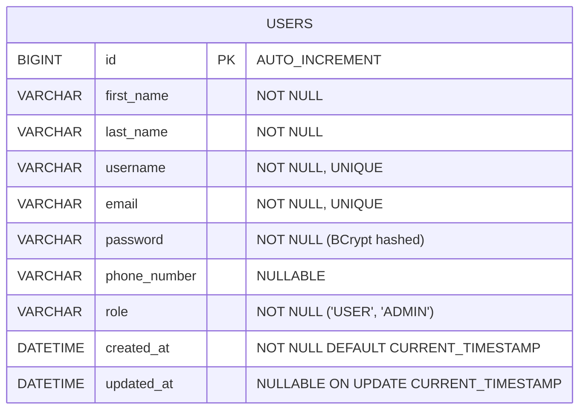
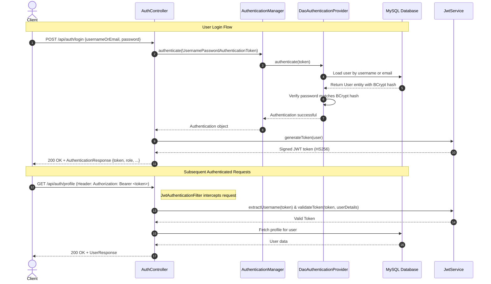

# 🚀 User Authentication & Authorization REST API Backend

> Production-ready, secure User Authentication and Role-Based Access Control system built with **Java 21**, **Spring Boot 3.3.4**, **Spring Security 6**, **JWT (JSON Web Tokens)**, **Spring Data JPA**, and **MySQL**.

---

## 📋 Table of Contents
1. [Project Overview](#-project-overview)
2. [Technology Stack](#-technology-stack)
3. [Architecture & Project Structure](#-architecture--project-structure)
4. [Database Schema & ER Diagram](#-database-schema--er-diagram)
5. [JWT Authentication Flow](#-jwt-authentication-flow)
6. [REST API Endpoints Specification](#-rest-api-endpoints-specification)
7. [API Workflow: Request to Database Response](#-api-workflow-request-to-database-response)
8. [Setup & Running Instructions](#-setup--running-instructions)
9. [API Testing with Postman & Swagger](#-api-testing-with-postman--swagger)
10. [Default Pre-seeded Credentials](#-default-pre-seeded-credentials)

---

## 🌟 Project Overview
This application delivers a production-grade backend service providing:
- **Stateless Authentication** with JSON Web Tokens (HMAC-SHA256).
- **Role-Based Access Control (RBAC)** supporting `USER` and `ADMIN` roles.
- **BCrypt Password Hashing** protecting stored user credentials.
- **Profile Management (CRUD)** allowing authenticated users to view, update, and delete their profile.
- **Admin Management Operations** restricted to users with the `ADMIN` role.
- **Unified Validation & Global Exception Handling** with structured JSON error messages.
- **Interactive Swagger/OpenAPI 3.0 UI** with Bearer authorization testing.

---

## 🛠 Technology Stack
| Layer / Tool | Technology | Description |
|---|---|---|
| **Language** | Java 21 LTS | Modern Java features and runtime efficiency |
| **Framework** | Spring Boot 3.3.4 | Core enterprise application framework |
| **Web MVC** | Spring Web | RESTful controllers, content negotiation |
| **Security** | Spring Security 6 | Filter chains, stateless session, RBAC |
| **Authentication** | JJWT (0.12.6) | HS256 signed JSON Web Tokens |
| **ORM / Data** | Spring Data JPA / Hibernate | Object-Relational Mapping & repositories |
| **Database** | MySQL 8.0+ | Production relational database (H2 fallback for tests) |
| **Validation** | Jakarta Bean Validation | JSR-380 request payload validation |
| **Documentation** | SpringDoc OpenAPI 2.6.0 | Interactive Swagger UI & OpenAPI 3 spec |
| **Build Tool** | Apache Maven & Maven Wrapper | Dependency management & automated builds |
| **Containerization**| Docker & Docker Compose | Containerized runtime & database orchestration |

---

## 🏛 Architecture & Project Structure

The project strictly follows a **Layered Architecture** adhering to separation of concerns:

```
src/main/java/com/example/authsystem
├── AuthApplication.java          # Spring Boot main application entry point
├── config                        # Infrastructure & security configurations
│   ├── ApplicationConfig.java    # Beans: UserDetailsService, PasswordEncoder, AuthManager
│   ├── DataInitializer.java     # CommandLineRunner seeding default Admin & User
│   ├── OpenApiConfig.java       # Swagger / OpenAPI 3 with JWT Bearer config
│   └── SecurityConfiguration.java# Spring Security 6 filter chain & route rules
├── controller                    # REST API controllers (HTTP handling & validation)
│   ├── AdminController.java     # Admin operations (@PreAuthorize("hasRole('ADMIN')"))
│   └── AuthController.java      # Auth & Profile endpoints (/api/auth/**)
├── dto                           # Data Transfer Objects (Request/Response models)
│   ├── ApiResponse.java         # Standard API wrapper {success, message, data}
│   ├── AuthenticationResponse.java # Token response {token, type, expiresIn, ...}
│   ├── LoginRequest.java        # Login credentials payload
│   ├── RegisterRequest.java     # User registration payload with validations
│   ├── UpdateProfileRequest.java# Profile update payload
│   └── UserResponse.java        # Safe user profile representation (no passwords)
├── entity                        # JPA Domain entities mapped to MySQL tables
│   ├── Role.java                # Role Enum: USER, ADMIN
│   └── User.java                # JPA Entity implementing Spring Security UserDetails
├── exception                     # Global exception handling & custom errors
│   ├── BadRequestException.java
│   ├── ErrorResponse.java       # Standard error format with validation errors map
│   ├── GlobalExceptionHandler.java # @RestControllerAdvice for uniform errors
│   ├── InvalidCredentialsException.java
│   ├── ResourceNotFoundException.java
│   └── UserAlreadyExistsException.java
├── repository                    # Spring Data JPA repositories
│   └── UserRepository.java      # Interface extending JpaRepository<User, Long>
├── security                      # Security filters & JWT handling
│   ├── CustomAccessDeniedHandler.java # 403 Forbidden handler
│   ├── JwtAuthenticationEntryPoint.java # 401 Unauthorized handler
│   ├── JwtAuthenticationFilter.java   # OncePerRequestFilter parsing Bearer tokens
│   └── JwtService.java          # Token generation, claims extraction & validation
└── util                          # Utility mappers and helper classes
    └── UserMapper.java          # Entity to DTO conversion utility
```

---

## 🗄 Database Schema & ER Diagram

### Entity-Relationship Diagram



### Table DDL: `users`
```sql
CREATE TABLE IF NOT EXISTS `users` (
    `id` BIGINT AUTO_INCREMENT PRIMARY KEY,
    `first_name` VARCHAR(50) NOT NULL,
    `last_name` VARCHAR(50) NOT NULL,
    `username` VARCHAR(50) NOT NULL UNIQUE,
    `email` VARCHAR(100) NOT NULL UNIQUE,
    `password` VARCHAR(255) NOT NULL,
    `phone_number` VARCHAR(20) DEFAULT NULL,
    `role` VARCHAR(20) NOT NULL,
    `created_at` DATETIME(6) NOT NULL DEFAULT CURRENT_TIMESTAMP(6),
    `updated_at` DATETIME(6) DEFAULT NULL ON UPDATE CURRENT_TIMESTAMP(6),
    INDEX `idx_users_username` (`username`),
    INDEX `idx_users_email` (`email`),
    INDEX `idx_users_role` (`role`)
) ENGINE=InnoDB DEFAULT CHARSET=utf8mb4 COLLATE=utf8mb4_unicode_ci;
```

---

## 🔐 JWT Authentication Flow



---

## 📡 REST API Endpoints Specification

### 1. Public Authentication Endpoints
| HTTP Method | Endpoint | Description | Access |
|---|---|---|---|
| `POST` | `/api/auth/register` | Register a new user account | Public |
| `POST` | `/api/auth/login` | Authenticate user and obtain JWT token | Public |

### 2. Protected User Profile Endpoints
| HTTP Method | Endpoint | Description | Access |
|---|---|---|---|
| `GET` | `/api/auth/profile` | Retrieve current authenticated user profile | Authenticated (`USER` or `ADMIN`) |
| `PUT` | `/api/auth/profile` | Update profile information | Authenticated (`USER` or `ADMIN`) |
| `DELETE` | `/api/auth/profile` | Delete current user account | Authenticated (`USER` or `ADMIN`) |

### 3. Protected Admin Management Endpoints
| HTTP Method | Endpoint | Description | Access |
|---|---|---|---|
| `GET` | `/api/admin/users` | List all registered users | `ADMIN` only |
| `GET` | `/api/admin/users/{id}` | Get specific user by ID | `ADMIN` only |
| `DELETE` | `/api/admin/users/{id}` | Delete user by ID | `ADMIN` only |

---

### Request & Response Samples

#### 1. User Registration (`POST /api/auth/register`)
**Request Body:**
```json
{
  "firstName": "John",
  "lastName": "Doe",
  "username": "johndoe",
  "email": "john.doe@example.com",
  "password": "SecurePassword123",
  "phoneNumber": "+1234567890",
  "role": "USER"
}
```
**Response (201 Created):**
```json
{
  "success": true,
  "message": "User registered successfully",
  "timestamp": "2026-10-15T17:00:00"
}
```

#### 2. User Login (`POST /api/auth/login`)
**Request Body:**
```json
{
  "usernameOrEmail": "johndoe",
  "password": "SecurePassword123"
}
```
**Response (200 OK):**
```json
{
  "token": "eyJhbGciOiJIUzI1NiJ9.eyJzdWIiOiJqb2huZG9lIiwicm9sZXMiOlsiUk9MRV9VU0VSIl0...",
  "type": "Bearer",
  "expiresIn": 86400000,
  "username": "johndoe",
  "email": "john.doe@example.com",
  "role": "USER",
  "message": "Authentication successful"
}
```

#### 3. Get Profile (`GET /api/auth/profile`)
**Header:** `Authorization: Bearer <jwt-token>`  
**Response (200 OK):**
```json
{
  "id": 2,
  "firstName": "John",
  "lastName": "Doe",
  "username": "johndoe",
  "email": "john.doe@example.com",
  "phoneNumber": "+1234567890",
  "role": "USER",
  "createdAt": "2026-10-15T16:00:00",
  "updatedAt": "2026-10-15T16:00:00"
}
```

#### 4. Validation Error Sample (400 Bad Request)
```json
{
  "timestamp": "2026-10-15T17:05:00",
  "status": 400,
  "error": "Bad Request",
  "message": "Validation failed for input data",
  "path": "/api/auth/register",
  "validationErrors": {
    "email": "Email should be valid",
    "password": "Password must be at least 6 characters"
  }
}
```

---

## 🔄 API Workflow: Request to Database Response

1. **Client Request**:
   The client sends an HTTP request (e.g. `POST /api/auth/login` or `GET /api/auth/profile` with an `Authorization: Bearer <token>` header).
2. **Filter Chain & Security**:
   - `JwtAuthenticationFilter` intercepts the request.
   - If a Bearer token is present, `JwtService` parses the token and extracts the subject (username).
   - `UserDetailsService` retrieves the `UserDetails` from MySQL.
   - `JwtService.isTokenValid()` verifies token signature and expiration.
   - `UsernamePasswordAuthenticationToken` is set into the `SecurityContextHolder`.
3. **Controller Layer**:
   - `AuthController` receives the validated request.
   - Performs DTO validation using `@Valid`. If constraints fail, `GlobalExceptionHandler` intercepts and returns HTTP 400.
4. **Service Layer**:
   - The Controller calls `AuthService` or `UserService`.
   - Business logic is executed (duplicate checks, BCrypt encoding, profile field updates).
5. **Repository Layer**:
   - Spring Data JPA generates optimized SQL queries through Hibernate.
6. **Database Execution**:
   - MySQL executes the query, persisting or retrieving rows.
7. **DTO Conversion & Response**:
   - Entity objects are mapped to DTOs (`UserResponse`, `ApiResponse`) by `UserMapper`.
   - Controller sends the structured response with the appropriate HTTP status code (`200 OK`, `201 Created`).

---

## ⚙️ Setup & Running Instructions

### Prerequisites
- **Java 21 JDK** installed (`java -version`)
- **MySQL 8.0+** running locally (or Docker)
- **Maven** (included via wrapper `./mvnw` or `.\mvnw.cmd`)

### Option A: Local Run with MySQL

1. **Clone the repository**:
   ```bash
   git clone https://github.com/Siddhantk03/Repo_BackEnd_App.git
   cd Repo_BackEnd_App
   ```

2. **Configure Database Connection**:
   Open `src/main/resources/application.properties` and verify your MySQL credentials:
   ```properties
   spring.datasource.url=jdbc:mysql://localhost:3306/auth_db?createDatabaseIfNotExist=true&useSSL=false&allowPublicKeyRetrieval=true&serverTimezone=UTC
   spring.datasource.username=root
   spring.datasource.password=root
   ```
   *(Or pass via environment variables `DB_URL`, `DB_USERNAME`, `DB_PASSWORD`)*

3. **Build and Run the Application**:
   - **On Windows (PowerShell/CMD)**:
     ```powershell
     .\mvnw.cmd spring-boot:run
     ```
   - **On Linux/macOS**:
     ```bash
     chmod +x mvnw
     ./mvnw spring-boot:run
     ```

4. **Run with In-Memory H2 Profile (No MySQL needed)**:
   ```powershell
   .\mvnw.cmd spring-boot:run -Dspring-boot.run.profiles=h2
   ```

---

### Option B: Run with Docker Compose

Spin up both MySQL and the Spring Boot application in isolated containers with one command:
```bash
docker compose up --build -d
```
To stop the services:
```bash
docker compose down
```

---

## 🧪 API Testing with Postman & Swagger

### 1. Interactive Swagger UI
Once the application starts, navigate to:
👉 **[http://localhost:8080/swagger-ui/index.html](http://localhost:8080/swagger-ui/index.html)**

- Click **Authorize** (top right).
- Enter `Bearer <your_token>`.
- Test any protected endpoint interactively!

### 2. Postman Collection
A complete, pre-configured collection is included in the project:
📁 `postman_collection.json`

**How to use:**
1. Open Postman -> Click **Import** -> Select `postman_collection.json`.
2. Execute **Login**: The test script automatically captures the returned JWT token and stores it in the `jwtToken` variable.
3. Execute any protected request (`GET /api/auth/profile`, etc.) — the Bearer token is automatically attached!

---

## 🔑 Default Pre-seeded Credentials

The application includes an automated `DataInitializer` that seeds the following test accounts upon startup:

| Role | Username | Email | Password |
|---|---|---|---|
| **ADMIN** | `admin` | `admin@example.com` | `AdminPassword123` |
| **USER** | `johndoe` | `john.doe@example.com` | `UserPassword123` |

---

## 📄 License
This project is open-source under the [Apache 2.0 License](LICENSE).
